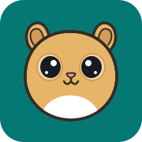

# Zzik : AI 사용량 대시보드

## 아키텍처

- **화면 구성**:
  - `/` (공개): 프로젝트 소개 페이지(아키텍처·기능 요약, `/usage`·`/trend` 이동 링크)
  - `/usage` (Cloudflare Access 보호): AI 사용량 대시보드 — 페이스 칩·한도 카드·사용량 추이 차트(uPlot)로 6개 제공자(Claude, ChatGPT(Codex), Antigravity, OpenCode, Grok, Ollama)의 사용률을 보여 준다.
  - `/trend` (공개): AI 모델 트렌드 — 요금제 추가 모델(`plan-models`), 신규 모델(`new-models`), 무료 모델(`free-models`), 점유율·순위 지표(`metrics`), 참고 링크를 제공한다.
- **공개 / 비공개 경로**:
  - 공개(인증 없음, 캐시 `public, max-age=300`): `/`, `/trend`, `/pub/trend*`
  - 비공개(Cloudflare Access + Worker JWT 검증): `/usage`, `/usage/*`, `/api/usage*`, `/api/usage-history*`
- **사용량 수집기**: PM2 상주 프로세스로 6개 제공자의 사용량을 읽어 D1에 저장하고, 값 변화·6시간 경과 시 이력을 남기며 주의·위험 진입/해제와 최상위 한도 리셋을 Discord로 알린다(상세 주기·설정은 `docs/harness/operations.md` 참고). Grok 자격 증명은 `~/.grok/auth.json`의 access token과 만료만 읽으며 로그인·갱신은 Grok Build가 소유한다.
- **트렌드 수집과 데이터 출처·약관**:
  - Worker cron이 2시간마다(`7 */2 * * *`) 모델 목록을, 일 1회(`17 0 * * *`, 00:17 UTC) 점유율 지표를 D1에 갱신한다.
  - `models.dev` (`api.json`, MIT)·`Ollama` (`/api/tags`, 공식 문서 직접 요청 허용)·`OpenRouter Data API` (`rankings-daily`, CC BY 4.0 — 점유율·순위 변동만 공개, 토큰 절대값 미공개)는 허용 출처이며, `OpenRouter Models API`·`OpenCode Zen`/`OpenCode Go`는 공개 카탈로그 링크·최소 필드·2시간 이상 주기 등 조건부로 사용한다.
  - `Artificial Analysis (AA)`는 무료·Pro 티어 모두 공개 대시보드·JSON API 재배포가 불가(내부용 전용)하므로 **공개하지 않는다**(`TREND_AA_PUBLIC='0'` 유지, 참고 링크만 제공).
- **프론트 구조**: `ui → app → domain` 방향으로만 의존하고, `infra`는 app이 주입한다.
