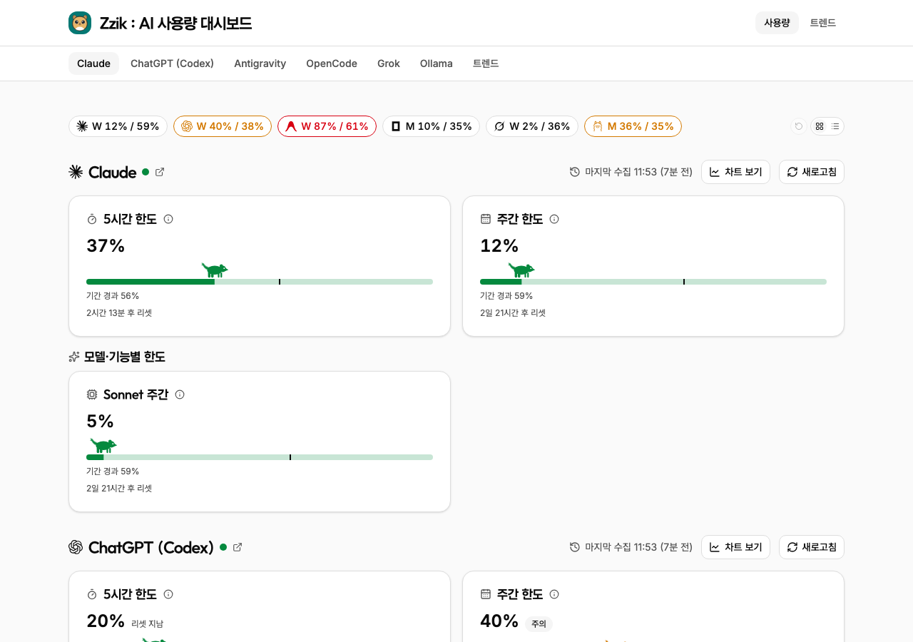

# Zzik : AI 사용량 대시보드

## 아키텍처

- **화면 구성**:
  - `/` (공개): 프로젝트 소개 페이지(아키텍처·기능 요약, `/usage`·`/trend` 이동 링크)
  - `/usage` (Cloudflare Access 보호): AI 사용량 대시보드 — 페이스 칩·한도 카드·사용량 추이 차트(uPlot)로 7개 제공자(Claude, ChatGPT(Codex), Antigravity, OpenCode, Grok, Ollama, Z.AI)의 사용률을 보여 준다. OpenCode Go·Ollama·Z.AI의 off-peak 구간은 배지와 Discord 알림으로 알린다. 하단의 접이식 트렌드 패널은 AA 지표(지능 상위 20, 출력 단가·작업당 비용 최저 20, 속도·TTFT 10)를 내부용으로 보여 주며 접기/펼치기 상태를 브라우저에 기억한다.
  - `/trend` (공개): AI 모델 트렌드 — 성능 지표(OpenRouter 점유율·순위, `metrics`), 신규 모델(최근 7일 OpenRouter 등록, `new-models`), 무료 모델(OpenCode Go 무료 항목, `free-models`), AA 기준 "요즘 주목받는 모델" 한 문장(계열별 대표 이름과 버전, 예: Claude Opus 5.5), 참고 링크(Artificial Analysis·Cognition·Arena·OpenRouter·OpenCode·models.dev)를 보여 준다. 요금제 추가 관측(`plan-models`)은 수집·API만 유지한다.
- **공개 / 비공개 경로**:
  - 공개(인증 없음, 캐시 `public, max-age=60, stale-while-revalidate=300`): `/`, `/trend`, `/pub/trend*`
  - 비공개(Cloudflare Access + Worker JWT 검증): `/usage`, `/usage/*`, `/api/usage*`, `/api/usage-history*`
- **사용량 수집기**: PM2 상주 프로세스로 7개 제공자의 사용량을 읽어 D1에 저장하고, 값 변화·6시간 경과 시 이력을 남기며 주의·위험 진입/해제와 최상위 한도 리셋을 Discord로 알린다(상세 주기·설정은 `docs/harness/operations.md` 참고). Grok 자격 증명은 `~/.grok/auth.json`의 access token과 만료만 읽으며 로그인·갱신은 Grok Build가 소유한다.
- **트렌드 수집과 데이터 출처·약관**:
  - Worker cron이 4시간마다(`7 */4 * * *`) 모델 목록을, 일 1회(`17 0 * * *`, 00:17 UTC) 점유율 지표를 D1에 갱신한다.
  - `models.dev` (`api.json`, MIT)·`Ollama` (`/api/tags`, 공식 문서 직접 요청 허용)·`OpenRouter Data API` (`rankings-daily`, CC BY 4.0 — 점유율·순위 변동만 공개, 토큰 절대값 미공개)는 허용 출처이며, `OpenRouter Models API`·`OpenCode Zen`/`OpenCode Go`는 공개 카탈로그 링크·최소 필드·2시간 이상 주기(현재 4시간) 등 조건부로 사용한다.
  - `Artificial Analysis (AA)`는 무료·Pro 티어 모두 공개 대시보드·JSON API 재배포가 불가(내부용 전용)하므로 **표·순위·점수는 공개하지 않는다**. 공개 화면에는 순위·점수 없이 모델 이름만 나열한 주목 모델 문장과 참고 링크만 두고, 표는 Access 뒤 `/usage`에서만 보여 준다.
- **프론트 구조**: `ui → app → domain` 방향으로만 의존하고, `infra`는 app이 주입한다.
