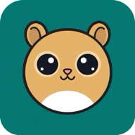
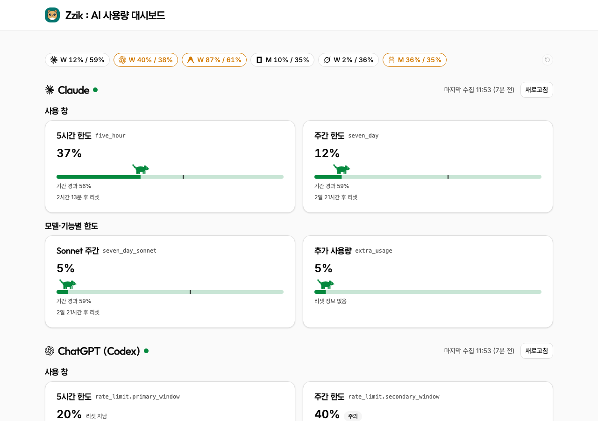

# Zzik : AI 사용량 대시보드

## 아키텍처

- 수집기는 PM2 상주 프로세스로 900초마다 6개 제공자(Claude, ChatGPT(Codex), Antigravity, OpenCode, Grok, Ollama)의 사용량을 읽어 Postgres에 저장한다. 값이 바뀌거나 6시간이 지나면 이력을 남기고, 주의·위험 진입/해제와 최상위 한도 리셋은 Discord로 알린다.
- Worker는 `/api/usage*`에서 저장된 사용량을 돌려주고, 정적 자산과 API는 Cloudflare Access 뒤에서 보호된다.
- 프론트는 `ui → app → domain` 방향으로만 의존하고, `infra`는 app이 주입한다. 화면은 페이스 칩·한도 카드·사용량 추이 차트(uPlot)로 사용률을 보여 준다.
